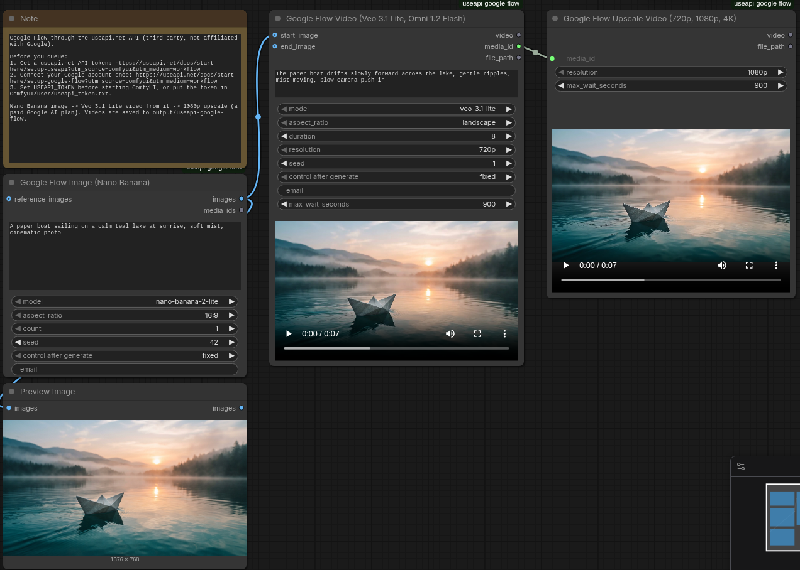

# Google Flow nodes for ComfyUI (Veo 3.1, Omni 1.2 Flash, Nano Banana)

Make Veo 3.1 Lite and Omni 1.2 Flash videos, Nano Banana images and 1080p / 4K video upscales from ComfyUI, on **your
own Google AI plan**. The nodes call Google Flow through the [useapi.net Google Flow API](https://useapi.net/docs/api-google-flow-v1?utm_source=comfyui&utm_medium=github).
Generations use your Google account's Flow credits, not per-second Comfy credits.

useapi.net is a third-party API service. It is not affiliated with Google.

Step-by-step tutorial: [Veo 3.1 and Nano Banana in ComfyUI](https://useapi.net/docs/articles/google-flow-comfyui?utm_source=comfyui&utm_medium=github).

## Nodes

| Node | What it does |
|---|---|
| **Google Flow Image (Nano Banana)** | Text to image, or edit with up to 10 reference images. Models: Nano Banana 2 Lite, Nano Banana 2.1 (`nano-banana-2`), Nano Banana Pro. 1 to 4 images per run, 5 aspect ratios or `auto` (the first reference's shape), seed. Outputs an IMAGE batch and the Google Flow media ids. |
| **Google Flow Video (Veo 3.1 Lite, Omni 1.2 Flash)** | Text to video, or start from an image and optionally end on one. Landscape or portrait. Veo 3.1 Lite: 720p, 8 s (4 and 6 s on Google AI Ultra). Omni 1.2 Flash: 360p or 720p, 3 to 15 s (above 10 s on a paid plan). Outputs a VIDEO, the media id and the saved MP4 path. |
| **Google Flow Upscale Video (720p, 1080p, 4K)** | Upscales a Google Flow video of up to 15 s (720p is for 360p clips). 720p and 1080p need a paid Google AI plan (Plus, Pro or Ultra); 4K needs Google AI Ultra. Connect `media_id` from the video node. |

Videos are saved to `ComfyUI/output/useapi-google-flow/` and previewed on the node. The VIDEO output also works with
ComfyUI's own Save Video and video nodes.

## What you need

1. A Google account with Google Flow. Images and videos work on the free tier; a Google AI Plus, Pro or Ultra plan
   gives more Flow credits and Omni clips longer than 10 s, and upscaling needs one (4K needs Ultra).
2. A [useapi.net subscription and API token](https://useapi.net/docs/start-here/setup-useapi?utm_source=comfyui&utm_medium=github).
3. The Google account connected once at useapi.net: [Setup Google Flow](https://useapi.net/docs/start-here/setup-google-flow?utm_source=comfyui&utm_medium=github).
   You get 300 free captcha credits with your first account; after that, add your own captcha provider key.

## Install

- **ComfyUI-Manager:** search for `useapi-google-flow` (or "Google Flow") and install.
- **Comfy CLI:** `comfy node install useapi-google-flow`
- **By hand:** `cd ComfyUI/custom_nodes && git clone https://github.com/useapi/comfyui-google-flow`, then restart ComfyUI.
  The only dependency is `requests`, which ComfyUI installs already.

## Your API token

Set it once, outside ComfyUI, in either place:

- environment variable: `USEAPI_TOKEN=...` before you start ComfyUI, or
- a file: `ComfyUI/user/useapi_token.txt` holding just the token (restart not needed).

The nodes have no token field on purpose: ComfyUI copies node inputs into saved workflows, into the metadata of every
image and video it saves, and into its history, so a token typed into a node would travel with everything you share.

## Example workflows

In ComfyUI open **Templates** and search `google-flow`, or load them from [`example_workflows/`](example_workflows):

- `google-flow-image-to-video-upscale.json`: Nano Banana image → Veo 3.1 Lite video from it → 1080p upscale.
- `google-flow-text-to-video.json`: Omni 1.2 Flash text to video.
- `google-flow-nano-banana-edit.json`: edit a loaded image with Nano Banana.

## Good to know

- Each `email` field is optional. Leave it empty and useapi.net picks one of your connected Google accounts. Images you
  pass in are uploaded to that account first, because a generation can only use media from its own account.
- The video `seed` is not sent to Google. Change it (or set it to randomize) to queue a new take with the same settings.
- Cancel in ComfyUI stops a video or upscale node while it waits for the result (not during the upload or the
  submit request). A job already started at Google keeps running there.
- Errors come back as plain sentences: plan limits, captcha, an expired session, Google's moderation reasons.

## Links

- [Tutorial: Veo 3.1 and Nano Banana in ComfyUI](https://useapi.net/docs/articles/google-flow-comfyui?utm_source=comfyui&utm_medium=github)
- [Google Flow API docs](https://useapi.net/docs/api-google-flow-v1?utm_source=comfyui&utm_medium=github)
- [More Google Flow examples (n8n, Python, Node.js, Dify)](https://github.com/useapi/google-flow-api)
- [useapi.net](https://useapi.net/?utm_source=comfyui&utm_medium=github)

## License

MIT
